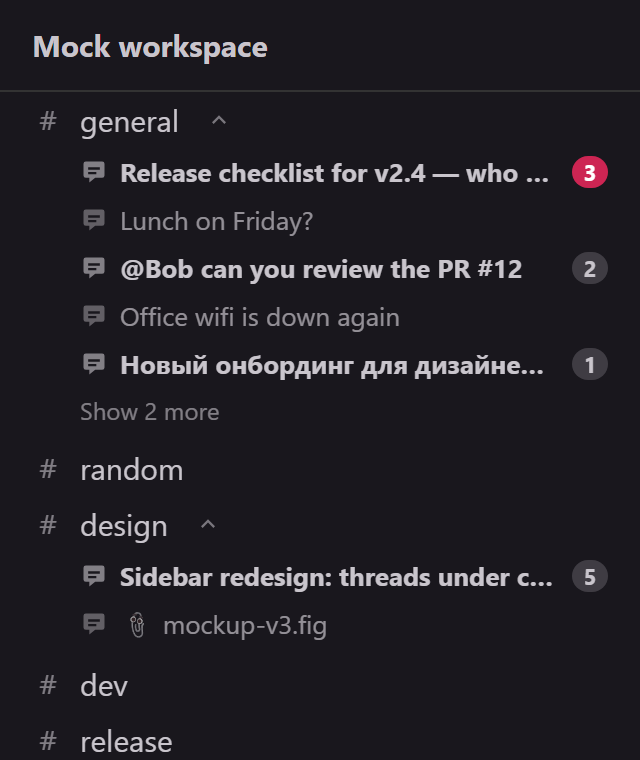

# Slack Channel Threads

Your active Slack threads, listed right under the channel they belong to — with unread counts,
mention badges and one click to open them.



Slack hides threads behind the separate **Threads** view. This puts them where the conversation
lives: under each channel (and DM) in the sidebar.

- Threads with activity in the last **3 days**, newest first, named after their first message
- **Bold** when unread, a count of unread replies, a **red badge** when you're mentioned
- Up to **5** per channel, then *Show N more*
- A **chevron** next to the channel name collapses its threads (remembered); a red dot shows
  unread activity in a collapsed channel
- **Click** opens the thread in Slack's side panel and clears its badge
- Refreshes every 30 seconds and when Slack gets focus

It shows the threads you follow — the same set as Slack's own Threads view.

> Unofficial. Not affiliated with or endorsed by Slack. It reads Slack's web client and internal
> APIs with your own session, so a Slack update can break it (Slack keeps working; the thread
> list just disappears until this is fixed). Check your workplace's policy before using client
> modifications on a work account.

## Requirements

- Windows, Slack desktop app (tested: Microsoft Store build 4.53)
- [Node.js](https://nodejs.org) 22 or newer on `PATH`

macOS: the script and the watcher are platform-neutral, but the installer is Windows-only and
nothing has been tested on a Mac yet.

## Install

```powershell
git clone https://github.com/davidmcarati/slack-channel-threads.git
cd slack-channel-threads
powershell -ExecutionPolicy Bypass -File install.ps1
```

The installer:

1. copies `slack-threads-watcher.mjs` and `slack-channel-threads.js` to
   `%LOCALAPPDATA%\SlackThreads\app`
2. sets the user environment variable `SLACK_DEVELOPER_MENU=true`, which makes Slack show its
   **View → Developer** menu
3. adds a Startup shortcut that runs the watcher hidden at Windows sign-in, and starts it now

Then quit Slack completely (`Ctrl+Q`) and start it again so it picks up the variable.

## Daily use

After Slack starts, open its menu (☰ or `Alt`) → **View → Developer → Enable Main Process
Inspector**. That's the only step. Within two seconds the threads appear, and they stay — through
page reloads and workspace switches — until Slack quits.

## Uninstall

```powershell
powershell -ExecutionPolicy Bypass -File install.ps1 -Uninstall
```

Removes the shortcut, stops the watcher and removes `SLACK_DEVELOPER_MENU`. Delete
`%LOCALAPPDATA%\SlackThreads` to remove the files and logs.

## How it works

Slack doesn't load extensions, its app files can't be patched (the Store build is read-only and
Electron's asar integrity check is on), and it refuses `--remote-debugging-port` on your real
profile. What it does ship is a developer menu item that opens a Node inspector for its main
process on `127.0.0.1:9229`.

- **`slack-threads-watcher.mjs`** polls that port. When it opens, it connects once and, inside
  Slack's main process, injects the script into the open Slack page and hooks `dom-ready` on every
  web contents so the script is injected again after each reload.
- **`slack-channel-threads.js`** runs in the Slack page. It fetches your followed threads with
  `subscriptions.thread.getView` (the call behind Slack's Threads view), draws them under the
  matching sidebar rows, and opens a thread through the same desktop hook Slack uses when you
  click a thread notification. Slack's sidebar is a virtualized list of absolutely positioned
  rows, so the script shifts the rows below each thread block and grows the list so scrolling
  still reaches the bottom.

### Security note

While **Enable Main Process Inspector** is on, any program on your computer can connect to
`127.0.0.1:9229` and run code inside Slack with your session. It's only reachable locally. Once
the threads appear you can switch it off again from the same menu — the reload hook stays until
Slack quits.

## Settings

Stored per Slack client in local storage. Run them in a DevTools console attached to the Slack
page, or from this repo with the inspector on:

```powershell
node tools/inject.mjs eval "SCT.setDays(7)"         # active window in days (0 = off)
node tools/inject.mjs eval "SCT.setMaxVisible(8)"   # threads before "Show N more"
```

## Development

- `test/mock-slack.html` — a fake Slack sidebar (virtualized like the real one) with mocked API
  answers. Serve the repo folder (`python -m http.server`) and open
  `/test/mock-slack.html` (`?flow` for a non-virtualized list).
- `tools/inject.mjs` — with the inspector on: `node tools/inject.mjs` injects the local script
  and prints `SCT.diag()`; also `diag`, `stop`, `list`, `devtools` (opens DevTools for the Slack
  page), `eval "<js>"`.
- In the page: `SCT.diag()` reports what the script found, `SCT.refresh()`, `SCT.stop()`.

Logs: `%LOCALAPPDATA%\SlackThreads\watcher.log`.

## License

MIT
